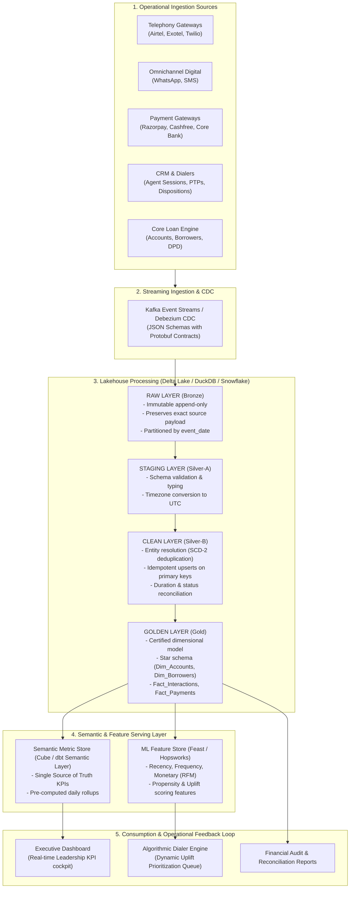

# PRODUCTION ANALYTICS ARCHITECTURE SPECIFICATION

**Document Version:** 1.0.0  
**Target Audience:** VP of Data Engineering, Chief Technology Officer, Analytics Engineering Lead  
**System Name:** CredSolve Enterprise Intelligence Platform (EIP)  
**Architecture Pattern:** Medallion Data Mesh (Raw → Staging → Clean → Golden → Feature → Metrics → Executive Dashboard)  

---

## 1. Architectural Blueprint & Data Flow



---

## 2. Layer-by-Layer Architectural Specification

### Layer 1: Raw Layer (Bronze)
- **Role:** Immutable, append-only landing zone storing raw event payloads directly from telephony webhooks, payment callbacks, CRM exports, and database CDC (Change Data Capture) feeds.
- **Storage Format:** Parquet / Delta Lake partitioned by `ingestion_year/ingestion_month/ingestion_day`.
- **Policy:** Never modify raw data. Include ingestion metadata: `_ingested_at`, `_source_system`, `_raw_payload_hash`.

### Layer 2: Staging Layer (Silver-A)
- **Role:** Schema validation, strict type casting, and timestamp normalization.
- **Transformations:**
  - Standardize all source timestamps (`Asia/Kolkata`, `UTC`, `Asia/Dubai`) into canonical **UTC timestamps**.
  - Enforce field types (amounts as `DECIMAL(18,2)`, IDs as standardized strings, status strings capitalized).
  - Strip leading/trailing whitespaces from borrower phone numbers and names.

### Layer 3: Clean Layer (Silver-B)
- **Role:** Entity resolution, SCD Type-2 state deduplication, and data quality enforcement.
- **Core Operations:**
  - **Entity Resolution on Borrowers:** Partition by `borrower_id` ordered by `updated_at DESC` to maintain exactly one current record per customer.
  - **Agent Seat Normalization:** Separate physical human employees (`employee_code`) from dialer license seats (`agent_id`).
  - **Payment Status Isolation:** Separate authorized cash collections (`payment_status = 'SUCCESS'`) from transient attempts (`FAILED`, `PENDING`, `REVERSED`).
  - **Telephony Duration Sanitation:** Set `talk_duration_sec = 0` for non-connected call statuses (`BUSY`, `FAILED`, `NO_ANSWER`, `VOICEMAIL`).

### Layer 4: Golden Layer (Gold / Dimensional Warehouse)
- **Role:** Certified, business-ready star schema serving executive reporting, data science, and operational dialers.
- **Tables:**
  - `dim_borrowers`: Resolved borrower master with verified contact info and geography.
  - `dim_accounts`: Loan book with opening balances, current DPD, risk segments, and orphan flags.
  - `dim_agents`: Collection agent directory with vendor and team mappings.
  - `fact_payments`: Deduplicated success payments linked to banking settlement references.
  - `fact_omnichannel_interactions`: Unified event stream across Voice, WhatsApp, SMS, and Field.
  - `bridge_payment_attribution`: Event-level multi-touch attribution connecting payments to interactions within 24h, 72h, 7d, and 30d windows.

### Layer 5: Semantic & Metric Layer
- **Role:** Eliminates ad-hoc logic discrepancies in BI tools by defining KPI mathematical formulas once in code (e.g. dbt semantic layer / Cube).
- **Core Standard Metrics:**
  - `daily_recovery_run_rate = SUM(success_amount) / calendar_days`
  - `contact_rate = COUNT(DISTINCT connected_accounts) / COUNT(DISTINCT dialed_accounts)`
  - `rpc_rate = COUNT(verified_rpc_dispositions) / COUNT(answered_calls)`
  - `ptp_kept_rate = COUNT(ptp_with_ledger_match_within_7d) / COUNT(total_ptps)`
  - `attributed_recovery_rate_7d = SUM(payments_with_touch_le_7d) / total_outstanding`

---

## 3. Production Data Contracts & Schema Evolution

Each upstream system integration must sign an explicit **Data Contract** defining payload types, nullability, and primary key constraints.

### Example Contract: Payments Ingestion Contract (`payments.v2.json`)
```json
{
  "$schema": "http://json-schema.org/draft-07/schema#",
  "title": "PaymentEventContract",
  "type": "object",
  "properties": {
    "payment_id": { "type": "string", "pattern": "^PAY[0-9]{7,10}$" },
    "account_id": { "type": "string", "pattern": "^ACC[0-9]{7,10}$" },
    "borrower_id": { "type": ["string", "null"] },
    "event_at_utc": { "type": "string", "format": "date-time" },
    "payment_reference": { "type": "string", "minLength": 6 },
    "amount": { "type": "number", "minimum": 0.01 },
    "currency": { "type": "string", "enum": ["INR"] },
    "payment_status": { "type": "string", "enum": ["SUCCESS", "FAILED", "PENDING", "REVERSED"] },
    "payment_method": { "type": "string", "enum": ["UPI", "NETBANKING", "CARD", "NACH", "CASH"] },
    "provider_id": { "type": "string" }
  },
  "required": ["payment_id", "account_id", "event_at_utc", "payment_reference", "amount", "payment_status"]
}
```

---

## 4. Engineering Implementation: Operational Mechanics

### A. Incremental Processing & Watermarking
- **Engine:** Apache Spark Structured Streaming or dbt Incremental Models using DuckDB / Snowflake.
- **Watermark Window:** Set a 72-hour sliding watermark (`event_at >= CURRENT_TIMESTAMP - INTERVAL 72 HOURS`) to capture late-arriving batch bank clearances and telephony disposition wrap-ups without requiring full historical warehouse scans.
- **Merge Strategy:** Idempotent `MERGE INTO target USING staging ON target.id = staging.id WHEN MATCHED THEN UPDATE WHEN NOT MATCHED THEN INSERT`.

### B. Late-Arriving Data & Backfill Strategy
- **Late Payments:** Payments arriving 5–10 days post-transaction (e.g. NACH mandates or cheque clearances) are ingested with their original `event_at` timestamp. Downstream attribution bridges and monthly KPI tables recalculate the affected monthly partition automatically.
- **Historical Backfills:** Every pipeline model is authored to be 100% deterministic and replayable from raw bronze files. Backfill jobs process partition-by-partition with partition overwrite locks.

### C. Automated Data Quality Gates (Great Expectations / Soda Core)
Before any data promotes from Clean to Golden:
1. **Uniqueness Check:** Zero duplicate primary keys on `payment_id`, `call_id`, `interaction_id`.
2. **Referential Integrity:** 100% of `fact_payments.account_id` must resolve to `dim_accounts.account_id`.
3. **Value Range Boundaries:** Call durations must be $\ge 0$ and $\le 3600$ seconds; payment amounts must be $> 0$.
4. **Time Compliance:** Alert if $> 0.5\%$ of collection calls occur outside 8:00 AM – 7:00 PM IST.
5. **Gateway Routing Guard:** Immediate high-priority PagerDuty incident if any calls are routed to a vendor flagged as `status = 'INACTIVE'`.

### D. Anomaly Detection & Operational Alerting
- **Z-Score Volume Monitor:** Automated daily checks tracking `daily_call_volume`, `daily_payments_count`, and `daily_success_amount`. Any deviation $> 3\sigma$ from the trailing 30-day moving average triggers Slack and email alerts to the analytics engineering on-call engineer.
- **Conversion Drift Monitor:** Real-time tracking of call connect rates and payment success rates. A sudden 500 bps drop indicates telecom carrier blacklisting or payment gateway downtime.
